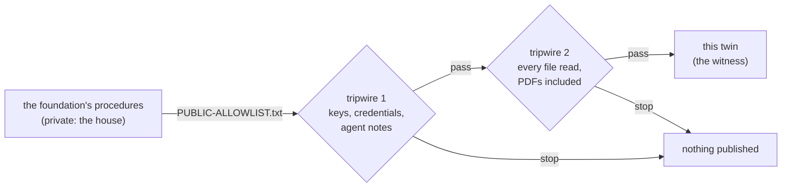

<picture>
  <source media="(prefers-color-scheme: dark)" srcset="https://raw.githubusercontent.com/theholyearthfoundation/.github/main/profile/assets/banner-dark.svg">
  
</picture>

#  The Holy Earth Foundation — Procedures, public twin

*How an approved thing is done, step by step, for anyone the foundation chooses to show.*

---

##  What this is

A **proposal** asks for a decision; a **procedure** (a standard operating procedure, SOP) says how an approved thing is
done, step by step, so a person or their helper can do it without the author in the room. The foundation keeps its
procedures in a private repository. This public twin carries **only the procedures an officer has listed**, copied
here by an allowlist sync.

##  What arrives here

On 2026-11-01 the allowlist was given the procedures every organisation in the family shares, with their PDFs and the
icons they draw:

| | Procedure |
|---|---|
|  | **SOP-COM-001** New to GitHub: your first hour |
|  | **SOP-OPS-001** How a change travels |
|  | **SOP-OPS-003** Private houses everything, public lanes witness |
|  | **SOP-IT-001** VPN and DNS resolver stalls |
|  | **SOP-IT-002** Reading room and helper access |
|  | **SOP-IT-003** Observer dashboards, local by default |
|  | **SOP-GOV-002** GitHub collaboration |

They arrive, as their markdown and their PDF in the same folders they have in the private repository (`COM/`, `OPS/`,
`IT/`, `GOV/`, `pdf/` and `assets/icons/`), on the **first sync after the sync's deploy key is provisioned**. Until then
this README is the only file here. Members read the full set today in the
[reading room](https://github.com/theholyearthfoundation/reading-room).

##  How it is kept

- **Nobody edits this repository by hand.** A sync in the private repository copies exactly the listed paths, after two
  tripwires: the first stops anything that looks like a credential or an internal note; the second reads **every**
  file, PDFs included, and refuses one no machine could read unless a person attested they read it. *A public lane
  never publishes a file a machine or a person has not read* (SOP-OPS-003).
- This README is the twin's own page; the sync never overwrites it.
- `main` cannot be deleted (a deletion-only ruleset).
- Every procedure is a **draft until its version is tagged** (`v1.0.0` is the first approved set); tagging is an
  officer's action.

##  Elsewhere

-  [The foundation →](https://theholyearthfoundation.github.io)
-  The public reading room (proposals, procedures and decks that are ready for visitors): <https://theholyearthfoundation.github.io/reading-room-public/>
-  [Welcome to The Holy Earth Foundation](https://github.com/theholyearthfoundation/.github/blob/main/decks/welcome.marp.pdf), the welcome deck
-  How every organisation in the family shapes its procedures: [`drasticstatic/my-template` → `sop-template/`](https://github.com/drasticstatic/my-template/tree/main/sop-template)
